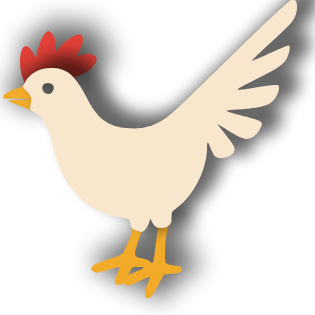
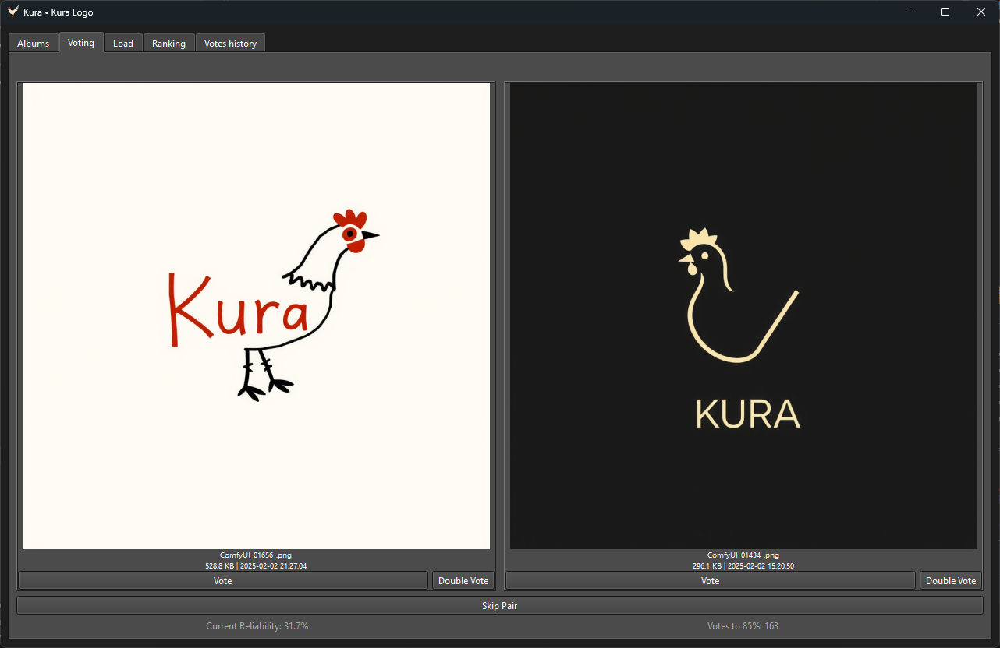
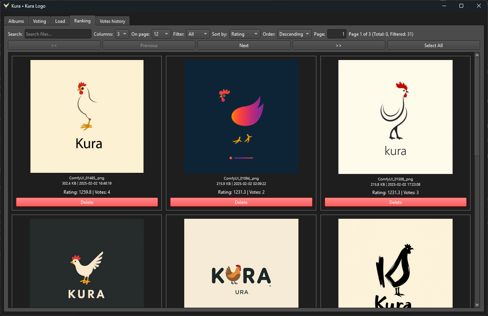

<p align="left"><a href="https://github.com/onlaj/Kura"></a></p>

<h1 align="left">Kura</h1>

 [](https://www.gnu.org/licenses/gpl-3.0)


Kura (pronounced "KOO-rah") is a Python tool for sorting images and videos by comparing them two at a time. It uses the Elo ranking system, the same one used in chess. It's useful when you have too many photos to sort manually and want more nuance than simple star ratings.

<p align="center">
  
  
</p>

## What's this for?

I built it mostly for organising AI-generated images. When you generate a few hundred of them, it's hard to tell which ones are actually the best, and going through them one by one gets tiring fast.

It also works well for blind tests. The voting screen doesn't show filenames, so you can compare photos from different phone cameras without knowing which one took which photo.

Basically, it's useful any time personal taste matters more than objective metrics.

## How it works

1. You compare two items
2. The winner's score goes up, the loser's goes down
3. Unexpected wins count for more (beating a higher-ranked image gives more points)
4. Repeat until the rankings look right

Kura also:
- Shows you the least-voted items first
- Balances comparisons between strong and weak items
- Tracks how settled the rankings are with a reliability score


## Features

- Media support: Images (JPG/PNG/WEBP), GIFs, and videos (MP4/MOV/MKV/M4V/WMV/WEBM)
- Viewing: Sort by score/votes/name, fullscreen previews, adjustable grid sizes, video previews
- Albums: Create albums, export/import rankings, handle missing files
- Vote history: See every vote you made and edit it if you change your mind
- Progress tracking: The reliability score shows when you've compared enough pairs ([threshold rationale](docs/reliability_thresholds.md))


## Why a hen?

"Kura" means "hen" in Polish, which is where the logo comes from. I generated 213 versions of it with AI and ranked them with the same Elo system Kura uses. This one came out on top.


## Getting started

### Option 1: Download pre-built executable
Pre-built versions of Kura are available for Windows and macOS in the [Releases](https://github.com/onlaj/Kura/releases) section.

> **Note:** Some antivirus software (including Windows Defender) may flag the `.exe` as a threat. This is a false positive caused by the way PyInstaller packages the application. If you get a warning, you can exclude the file in your antivirus software or run Kura from source instead.

### Option 2: Run from source (recommended)
This way you avoid the antivirus issues mentioned above.

Requirements:
- Windows, macOS or Linux
- Python 3.9+

#### 1. Install Python (if not installed)
- Windows: Download and install Python from [python.org](https://www.python.org/downloads/). Make sure to check **"Add Python to PATH"** during installation.
- macOS/Linux: Python 3 is usually pre-installed. Check by running `python3 --version`.

#### 2. Clone the project
```bash
# Download the project
git clone https://github.com/onlaj/Kura.git
cd Kura
```

#### 3. Create a virtual environment
```bash
# Linux/macOS
python3 -m venv venv
source venv/bin/activate

# Windows
python -m venv venv
venv\Scripts\activate
```

#### 4. Install dependencies and run
```bash
# Ensure pip is up to date
python -m pip install --upgrade pip

# Install required packages
python -m pip install -r requirements.txt

# Run the application
python main.py
```

### Building an executable
To create a single-file executable:
```
pyinstaller --onefile --windowed --icon="docs/favicon.ico" --add-data "docs/logo.png;docs" main.py
```
